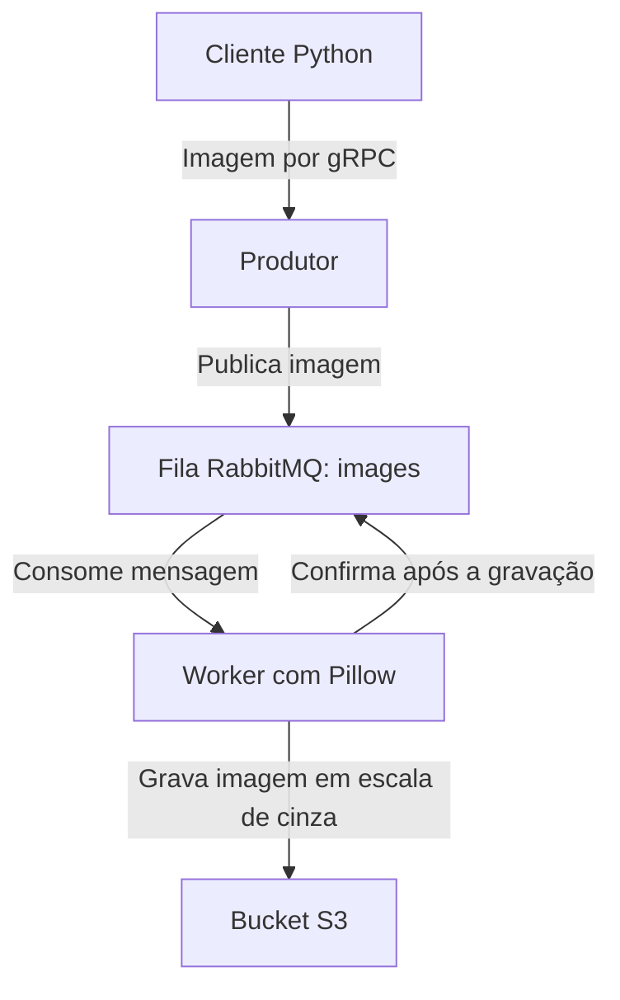

# Processamento distribuído de imagens na AWS

Projeto acadêmico que separa o recebimento de imagens do processamento assíncrono. O cliente envia a imagem por **gRPC**, o produtor a publica no **RabbitMQ** e o worker converte o conteúdo para escala de cinza antes de gravá-lo no **S3**.

**Python · gRPC/Protobuf · RabbitMQ · Pillow · boto3 · EC2 · S3 · CloudFormation**

## Arquitetura



A resposta de sucesso do produtor confirma o **enfileiramento**, não a conclusão do processamento. A conclusão precisa ser verificada no bucket e nos logs do worker. Não há endpoint de consulta de status.

## Estrutura

| Arquivo | Responsabilidade |
| --- | --- |
| [`app/client.py`](app/client.py) | Lê uma imagem e chama o serviço gRPC. |
| [`app/producer_server.py`](app/producer_server.py) | Publica o conteúdo e o nome do arquivo na fila `images`. |
| [`app/worker.py`](app/worker.py) | Converte a imagem e grava no S3; confirma a mensagem após a gravação. |
| [`app/image.proto`](app/image.proto) | Contrato da API gRPC. |
| [`cloudformation/template.yaml`](cloudformation/template.yaml) | Descrição de rede, instâncias, grupos de segurança e bucket. |

## Preparar uma execução de desenvolvimento

Requisitos: Python compatível com as dependências, RabbitMQ na máquina do produtor e acesso a um bucket S3 de teste. Use credenciais temporárias do ambiente AWS ou IAM Role, sem gravá-las nos arquivos.

```bash
python -m venv .venv
# Linux/macOS
source .venv/bin/activate
# Windows PowerShell: .\.venv\Scripts\Activate.ps1
python -m pip install "grpcio>=1.71.0" "protobuf>=5.29.0,<6" pika boto3 Pillow
```

As versões mínimas acima refletem os arquivos gRPC/Protobuf gerados. O repositório ainda não possui um arquivo de dependências fixado e esta revisão não instalou nem executou o sistema distribuído.

Com o RabbitMQ disponível, inicie o produtor em um terminal:

```bash
python app/producer_server.py
```

O produtor conecta ao RabbitMQ em `localhost` e usa o comportamento padrão de autenticação da biblioteca Pika. O código atual não oferece variáveis para usuário e senha do broker. Prepare a autenticação explicitamente antes de qualquer execução entre máquinas; não exponha o broker à internet.

Em outro terminal, configure o worker com os valores do seu ambiente de teste:

```bash
export RABBIT_HOST=127.0.0.1
export BUCKET_NAME=NOME_DO_SEU_BUCKET_DE_TESTE
python app/worker.py
```

No Windows PowerShell, use `$env:RABBIT_HOST='127.0.0.1'` e `$env:BUCKET_NAME='NOME_DO_SEU_BUCKET_DE_TESTE'`. O worker precisa de autorização para `s3:PutObject` no destino; a configuração depende do ambiente.

Por fim, envie uma imagem existente:

```bash
python app/client.py caminho/para/imagem.jpg 127.0.0.1:50051
```

O endereço do produtor também pode ser definido por `PRODUCER_GRPC_ADDRESS`. O caminho da imagem pode ser definido por `IMAGE_PATH` ou pelo primeiro argumento. O worker grava um nome como `imagem_gray.jpg`; imagens com o mesmo nome podem sobrescrever o mesmo objeto.

## CloudFormation: pontos pendentes antes de provisionar

O template registra a infraestrutura do exercício, mas ainda precisa de ajustes para uma implantação reproduzível:

- `ImageId` e `KeyName` são fixos; verifique disponibilidade na região e na conta escolhidas.
- Os outputs `ProducerPublicIP` e `S3BucketName` estão escritos como strings com `!GetAtt` e `!Ref` entre aspas. Corrija-os para funções intrínsecas antes de utilizá-los.
- O template não associa uma IAM Role ao worker. Configure o perfil da instância com permissão mínima para o bucket.
- O `UserData` instala parte das dependências, mas não copia nem inicia os scripts da aplicação; a configuração entre instâncias e a autenticação do broker também precisam ser concluídas.
- Restrinja `AllowedClientCidr` e `AllowedSshCidr` aos endereços necessários. Os padrões são `127.0.0.1/32` e não autorizam acesso remoto de clientes.

Revise esses pontos antes de criar recursos. Não há um deploy automatizado validado nesta revisão.

## Validação e limites

O fluxo foi demonstrado em ambiente acadêmico, conforme a documentação do projeto. Nesta revisão, a conferência foi feita por leitura do código e do template, sem novo provisionamento AWS.

- A fila é declarada com `durable=False` e as mensagens não são marcadas como persistentes.
- Não há TLS no gRPC, consulta de progresso, política explícita de retry ou fila de mensagens rejeitadas.
- Não há suíte automatizada, medição de carga ou garantia de disponibilidade.
- O compartilhamento da conexão Pika entre chamadas concorrentes do produtor precisa de revisão antes de aumentar a carga.

## Segurança e custos

Use apenas imagens de teste e recursos sob seu controle. Não publique credenciais, endpoints privados ou dados de clientes. Se alguma credencial de versões anteriores ainda estiver ativa, revogue-a no provedor: remover um valor do código não comprova revogação.

Instâncias EC2, armazenamento S3 e tráfego podem gerar cobranças. Ao encerrar, esvazie o bucket de teste e remova os recursos criados, conferindo se a exclusão da stack foi concluída.
